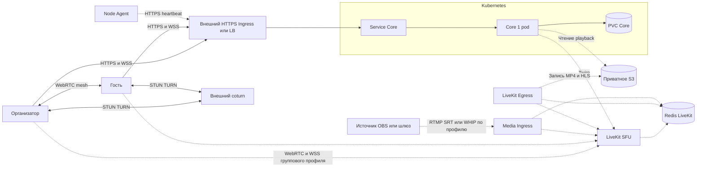

# Kubernetes для AgilFrame

27 ноября 2026 года. Проверены исходники рабочей копии и два Helm-чарта. Для первого пилота подходит один Core с постоянным томом и внешний TURN. Для группового профиля можно добавить внешний LiveKit. Кластер Kubernetes, производственный балансировщик и медиаузлы в рамках этого ревью не запускались.

## Что реально поставляет репозиторий

| Артефакт | Текущее поведение | Ограничение для Kubernetes |
|---|---|---|
| `agil-core` | Deployment с одним pod и `Recreate`, PVC, Service, ConfigMap, Secret, опциональные Ingress, NetworkPolicy, HPA и PDB. Startup, liveness и readiness направлены на `/v1/health`. | `Recreate` даёт простой при обновлении, а `/v1/health` проверяет жизнеспособность Core. HPA может масштабировать Deployment, но приложение сохраняет одну рабочую копию комнат на лидере. На первом пилоте оставить одну реплику и отключить HPA. [Значения](../../../infra/helm/agil-core/values.yaml#L28-L34) · [Пробы](../../../infra/helm/agil-core/values.yaml#L179-L202) · [Deployments](https://kubernetes.io/docs/concepts/workloads/controllers/deployment/) |
| `agil-node` | Один Deployment для одного идентификатора узла. Поднимает shell-цикл CLI регистрации и heartbeat на общем образе Core. Хранит `node.json` на PVC. Readiness по отметке heartbeat. | Чарт не содержит LiveKit, coturn и медиасетевой экспозиции. Масштабирование этого Deployment повторяет идентификатор узла. Команда install/restart Docker-модуля из Dashboard не создаёт объекты Kubernetes. [Deployment](../../../infra/helm/agil-node/templates/deployment.yaml#L47-L138) · [Цикл CLI](../../../infra/helm/agil-node/files/node-loop.sh) |
| All-in-one image | Другой агент, умеет запускать и наблюдать медиа, проверять внешний SFU и управлять Docker add-on через Engine. Есть локальные `/healthz`, `/readyz`, `/metrics`. | Compose, размещение на VM и Helm node loop имеют разные возможности. Для media workloads в Kubernetes нужен отдельный способ управления и инвентаризации. [Node Image](../../nodes/all-in-one/README.md) · [Готовность агента](../../nodes/all-in-one/agent/health.mjs#L113-L129) |
| Redis, S3, наблюдаемость | Чарты дают параметры окружения и базовые манифесты. Prometheus и медиа входят в другие deployment-пакеты. | Отдельно обеспечить Redis, объектное хранилище, Ingress Controller, метрики и доставку уведомлений. `AGIL_DATABASE_URL` из Helm не подключает PostgreSQL к текущему хранилищу Core. В отличие от упрощённого описания Helm README, `AGIL_REDIS_URL` уже используется текущим Core. [Чарты](../../../infra/helm/README.md) · [Конфиг Core](../../apps/server/src/env.ts#L877-L886) · [Prometheus](../../deploy/observability/prometheus.yml) |

При ревью обнаружили, что `default true` в Chart ConfigMap заменял явный `geoHeaderAllow=false`. Шаблон исправлен, повторный рендер дал `AGIL_GEO_HEADER_ALLOW: "0"`. Поведение приложения с заголовками осталось проверить через прокси в целевом кластере. [ConfigMap](../../../infra/helm/agil-core/templates/configmap.yaml#L20-L24) · [Чтение заголовка](../../apps/server/src/http.ts#L576-L587)

## Схема развёртывания пилота и подключаемых сервисов

Пунктир показывает компоненты за пределами минимального звонка. `Redis LiveKit` относится к SFU и worker. При HA Core добавляется собственная логическая зависимость Redis для lease, снимков и flow. Разместить TURN и, при необходимости, SFU вне Kubernetes разумно для первого пилота. Перенос внутрь требует воспроизводимой проверки ICE, прямой доступности UDP и эвакуации медиа для выбранного CNI и LB.

### Звонок по ссылке

Организатор создаёт комнату из Dashboard или доверенного бэкенда. Посылает обычный `joinUrl` комнаты. Гость открывает его и получает собственный краткоживущий токен через REST join, после чего устанавливается WS. `AGIL_ALLOW_ANONYMOUS=0` закрывает анонимное создание комнат. `security.requireToken=true` сохраняет токен для сигналинга. `requireVerifiedIdentity`, `waitingRoom`, `moderatorJoinFirst`, `passwordRequired` и `lockRoom` выключены, при создании нет `password` и списка разрешённых участников. Обычная ссылка открывает доступ гостю, пока комната доступна. Отдельный подписанный invite имеет роль и TTL, но его истечение не закрывает открытую комнату. Токен организатора не передаётся гостям. [Настройки](../../packages/protocol/src/config.ts#L967-L979) · [Обычная ссылка](../../apps/server/src/admin-api.ts#L250-L252) · [Выпуск invite](../../apps/server/src/admin-api.ts#L3340-L3374) · [Создание комнаты](../../apps/server/src/public-api.ts#L2153-L2175)

Профиль ограничивается микрофоном, камерой, выбором устройств и выходом. Ненужные чат, файлы, экран, запись, субтитры и помощники выключаются флагами `features` и, где применимо, соответствующим `session.*.enabled`. Серверные Egress и SIP отключены, внешний SFU нужен при переходе от пилота к групповой нагрузке. Приёмка пилота требует двух клиентов в разных сетях, двустороннего аудио и видео, отдельной проверки принудительного TURN и повторного входа после перезапуска Core. [Флаги клиента](../../packages/protocol/src/config.ts#L23-L65) · [Session profile](../../packages/protocol/src/config.ts#L786-L843) · Проверка TURN · Бизнес-анализ

## Сеть и границы полномочий

| Трафик | Практика размещения и проверка |
|---|---|
| Браузер → Core | HTTPS и WSS через Ingress. Проверить Upgrade на `/ws`, idle timeout относительно heartbeat, `X-Forwarded-*`, `AGIL_PUBLIC_ORIGIN`, смену WebSocket после переподключения. Для загрузок отдельно проверить размер тела запроса и время чтения. HTTP(S) Ingress не обслуживает UDP. [Ingress](https://kubernetes.io/docs/concepts/services-networking/ingress/) · [Примеры Ingress](../../../infra/examples/README.md) |
| Браузер → LiveKit | WSS для сигналинга. Профиль репозитория использует TCP `7881` и UDP `50000–50100` либо настроенный UDP mux. L4 Service или адрес узла должен соответствовать рекламируемым ICE-адресам и портам. Проверить UDP из внешней сети, затем TCP fallback. Для смешанных TCP/UDP Service проверить возможности выбранного LB. [Сеть SFU](../sfu-multinode.md) · [Пример переменных](../../nodes/all-in-one/.env.example#L78-L98) · [Kubernetes Service](https://kubernetes.io/docs/concepts/services-networking/service/) |
| Браузер и медиапиры → coturn | Пример использует `3478` UDP/TCP, `5349` TLS и relay `49200–49250`; применить фактические адреса и диапазоны среды. Проверить внешний relay-кандидат, оба направления пакетов, UDP и TCP/TLS, при необходимости IPv6, исчерпание allocations и продление учётных данных. [Пример TURN](../../nodes/all-in-one/.env.example#L117-L143) · Тесты TURN |
| Публикация и просмотр | RTMP требует TCP, SRT требует UDP, WHIP/WHEP используют HTTP для обмена сессией и нуждаются в отдельной достижимости медиакандидатов. HLS/MP4 идут через HTTPS и требуют проверки TTL подписи и Range. Порты Ingress и Viewer брать из выбранного профиля среды. [Медиапайплайны](../media-pipelines-roadmap.md) · [Egress S3](../egress-production-s3.md) |
| Core, workers, Node Agent | Core → Twirp своего LiveKit, workers → приватный Redis LiveKit, Core и Egress → S3 HTTPS с разными полномочиями. Удалённый Agent → Core HTTPS. Метрики, Redis, health и control workers держать на внутренних маршрутах. Для NetworkPolicy отдельно проверить поддержку CNI и учесть DNS, приватные сервисы и разрешённые IdP, вебхуки и хранилище. [Egress](../egress-production.md) · [NetworkPolicy](https://kubernetes.io/docs/concepts/services-networking/network-policies/) |

Core и chart node loop запускаются с ограниченным ServiceAccount, без доступа к Kubernetes API по умолчанию. Для нативных SFU/TURN/Egress/Ingress жизненным циклом владеют Helm/GitOps и оператор. Не подключать Docker Engine или сокет CRI к Core, агенту в общем namespace или Kubernetes API через права на произвольные workloads. Если узел действительно должен управлять Docker-модулями, сохранить отдельную VM с ограниченным сетевым доступом и отдельными ключами. Если выбранному медиапрофилю требуются `hostNetwork` или `hostPort`, выделить media namespace и node pool с отдельными допусками и проверить конфликт портов при обновлении. [Ограничения агента](../../nodes/all-in-one/README.md#docker-add-on-modules-optional) · [Pod Security Standards](https://kubernetes.io/docs/concepts/security/pod-security-standards/)

## Состояние, HA и восстановление

| Данные | Один Core | Условие перехода к HA |
|---|---|---|
| Снимки комнат, resume, сигналинг | Постоянный PVC сохраняет файловые снимки Core. При рестарте WS переподключается. Память процессов, медиа и лобби имеют собственный жизненный цикл. | Использовать Redis lease и `AGIL_ROOM_SNAPSHOT_STORE=redis`. Стенд обязан прогнать задержку восстановления после lease, потерю последнего окна снимка, WS resume, лобби и отдельно медиа. Redis не распределяет WS сессии и не переносит назначение уже работающего медиаузла. [Continuity](../call-continuity.md) |
| Tenant config, реестр, ключи, браузерные вложения/записи, аудит | PVC считывается новым pod. Проверить режим владения файлов и запись непривилегированным UID контейнера. | Общий `/app/.data` для нескольких Core не поддержан. Выбрать процедуру репликации и восстановления каждой категории или отдельно реализовать shared storage; согласовать RPO и проверку ACL. Redis‑режим flow покрывает ревизии flow при `AGIL_FLOW_STORE=redis`. [Ограничения HA](../ha-leader.md#остальные-ограничения) · [FlowStore](../../apps/server/src/flow-store.ts#L68-L116) |
| Публичная Wiki | Данные на PVC Core либо отдельный PVC. | `AGIL_DOCS_DATA_DIR` можно вынести в отдельное общее хранилище на Core с одинаковой сборкой. Проверить RWX, атомарное переименование, видимость версий и восстановление `.history`. [Хранилище Wiki](../ha-leader.md#публикации-wiki-и-история) · [Persistent Volumes](https://kubernetes.io/docs/concepts/storage/persistent-volumes/) |
| Серверная MP4/HLS | Приватное S3 для Egress, префиксы по среде и организации. Разрешения на запись у Egress и на чтение у Core. | Одинаковые правила хранения, подписи и доступ к объекту на обоих Core. Сохранять `AGIL_EGRESS_PLAYBACK_SECRET` и метаданные задачи. Ссылка после закрытия комнаты и каталог остаются открытой задачей SYS-01 даже при наличии S3. Системное ревью · [Приватный S3](../egress-production-s3.md) |
| Redis и секреты | Для mesh-пилота Redis и S3 можно отложить. Использовать `secrets.existingSecret` для стабильного offline-рендера и отдельный `existingSecret` на агента. | Для lease и flow обеспечить отказоустойчивость самого Redis и проверить потерю связи и восстановление. Развести логические зависимости Core и LiveKit, ACL и бэкапы. Согласовать одинаковые startup secrets для лидеров, совместимость токенов при ротации и процедуру повторного enrollment после потери тома. [Правила секретов Helm](../../../infra/helm/README.md#secrets) · [Модель lease](../ha-leader.md) |

Default PVC у Core использует `ReadWriteOnce`, который ограничивает запись по узлу и может допускать несколько pod на одном узле. Для строгой одиночной точки записи оценить `ReadWriteOncePod` при поддержке CSI или другой надёжный способ однописательного размещения. `Recreate` предотвращает параллельное обслуживание старым и новым ReplicaSet при штатном обновлении. При ручном удалении pod или аварии проверять, кто владеет томом, и учитывать зону storage class, время attach/detach, reclaim policy и восстановление на другой узел или зону. [Persistent Volumes](https://kubernetes.io/docs/concepts/storage/persistent-volumes/) · [Deployments](https://kubernetes.io/docs/concepts/workloads/controllers/deployment/)

## Готовность, drain, обновление

1. **Core single pod.** Использовать `/v1/health` как проверку процесса. Для первого запуска дождаться PVC, загрузки конфигурации и доступности WebSDK через внешний адрес. Принятие новой комнаты и WS контролировать отдельной синтетической проверкой. Блокировка на Redis или S3 не должна вызывать каскадные liveness-рестарты Core. [Пробы](https://kubernetes.io/docs/concepts/workloads/pods/probes/)
2. **Core HA.** Два кандидата на разных узлах и с раздельными PVC возможны после приёмки состояния и маршрутизации. Использовать `/v1/ready` в backend LB или `probes.readiness.path: /v1/ready` для образа с этим endpoint. Он включает только активный Core после восстановления комнат. Для liveness оставить `/v1/health`. Чарт по умолчанию оставляет `/v1/health` для совместимости с прежними образами. Проверить потерю lease, `409 not_leader`, отсутствие обычного `404` из-за попадания на standby и reconnect клиента после смены адресата. [Продвижение](../../apps/server/src/index.ts) · [Ограничения LB](../ha-leader.md#остальные-ограничения)
3. **Дренирование.** Сначала исключить новые назначения средствами продукта. Для SFU проверить число закреплённых активных комнат, для Egress незавершённые задачи и для TURN активные allocations. Затем выводить endpoint из нового трафика и завершать процесс. Kubernetes drain выселяет pod, а изменение EndpointSlice не перемещает действующие WS, RTP и TURN-сессии. `preStop` входит в grace period, поэтому сохранить время для Core shutdown, записи снимка и завершения соединений после SIGTERM. PDB ограничивает добровольные evictions, доступность одного pod всё равно зависит от возможности поднять замену. [Остановка Pod](https://kubernetes.io/docs/concepts/workloads/pods/pod-lifecycle/#pod-termination) · [Lifecycle hooks](https://kubernetes.io/docs/concepts/containers/container-lifecycle-hooks/) · [Disruptions](https://kubernetes.io/docs/concepts/workloads/pods/disruptions/) · [Core shutdown](../../apps/server/src/index.ts#L516-L574)
4. **Обновление.** Сделать резервную копию и контрольное восстановление состояния, закрепить digest приложений и workers, отрепетировать переход на копии PVC. Проверить совместимость WebSDK, сигналинга, LiveKit и форматов сохранения. Single pod обновлять в согласованное окно. Медиаузлы менять последовательно после drain. При откате образа проверить формат записанных данных, конфиг и Secret отдельно. Для внешнего Secret предусмотреть контролируемый rollout, его содержимое не учитывается pod template checksum. [Helm Deployment](../../../infra/helm/agil-core/templates/deployment.yaml#L24-L33) · Release operations

## Что измерять до приёмки

| Риск | Доказательство в стенде |
|---|---|
| Core жив, но звонок не работает | HTTP, WSS, выдача токена и двухклиентский тест с декодированными кадрами и аудио. Измерить задержку join, restore, число переподключений и ошибки `409/404/5xx`. Сверить текущего лидера и длительность lease. |
| Потеря медиа или переполнение узла | Метрики SFU, TURN и Agent, наблюдение за выбранной ICE-парой, потерями, RTT, RTP и кадровым декодированием. Ограничения ресурсов для Egress/Ingress проверять под измеренной нагрузкой. Core и медиа масштабируются по разным сигналам. |
| Приватное хранилище недоступно или закончилось место | Проверить доступность чтения и записи с разными полномочиями, рост PVC и временных данных worker, срок хранения, очистку зависших задач и восстановление резервной копии с доступом по подписанной ссылке. Сверить S3 lifecycle с политикой хранения клиента и сроком ссылок. |
| Потеря управления узлом или фоновым воркером | Следить за давностью heartbeat, модулями, пробами Ingress/Egress, активными и зависшими заданиями, памятью worker и временем подготовки нового узла. Выделить ответственных за Core, сетевой LB, media pool, Redis, S3 и сертификаты. |
| Обновление меняет клиентский путь и видимость сервиса | Сопоставить образ и digest с актом проверки, URL и сертификатами, внешними ICE и HLS/MP4 Range. Собирать события rollout, drain, PV attach и удаление endpoint. При отказе охранных проверок повторить на предыдущем образе и подтвердить данные. |

В репозитории есть заготовка blackbox HTTP/TCP для Core и LiveKit, метрики LiveKit, Egress и агента и правила оповещения. Для этой схемы проверить маршрутизацию мониторинга, реально подключённый Alertmanager, хранение логов, фильтрацию идентификаторов комнат и токенов и ответственного за реакцию на alert. Договориться о RTO / RPO до испытания failover и отдельно измерять время DNS/LB, Core и медиа. [Prometheus](../../deploy/observability/prometheus.yml) · [Правила](../../deploy/observability/agil-alerts.yml) · [Метрики Agent](../../nodes/all-in-one/agent/health.mjs#L132-L220)

## Локальная проверка 27 ноября

- `python agil/infra/tools/validate.py --quiet` вернул ноль ошибок и предупреждений. Скрипт проверяет YAML исходников, наличие и ссылки на значения шаблона, shell, Compose и ссылки Markdown. [Валидатор](../../../infra/tools/validate.py#L121-L186)
- Helm `v3.18.6` прошёл `helm lint` для обоих чартов. `helm template` и чтение отрендерённых YAML прошли для Core и Node с `existingSecret` и для Core с TLS, Ingress, HPA, PDB и NetworkPolicy. Рендер не требует настоящих ключей. Core рендерит `/v1/health` и `Recreate`. Node рендерит `/opt/agil/node-loop.sh`, `Recreate` и exec probes. Отдельный прогон зафиксировал `geoHeaderAllow=false` → `AGIL_GEO_HEADER_ALLOW: "1"`.
- В изолированном локальном Core две браузерные сессии прошли звонок 1:1 в direct/P2P. Бэкенд создал комнату при `AGIL_ALLOW_ANONYMOUS=0`, гость вошёл по ссылке без учётных данных. Проверка Kubernetes ingress и принудительного TURN-пути для этой конфигурации остаётся открытой. Бизнес-анализ
- Тесты текущего Core подтверждают восстановление комнаты при рестарте и Redis-переход владения flow. Деплой в кластер и проверка admission, CSI, CNI, Ingress Controller, публичного UDP, LB leader readiness, drain media и восстановления PVC остаются этапами приёмки Kubernetes. Результаты системного ревью
