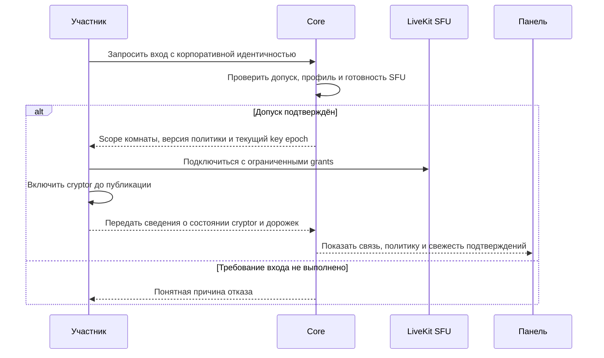

# Приватная комната руководства

27 ноября 2026 года. Проект требований к Core, WebSDK, панели и хранилищам. Текущие возможности и результаты проверок указаны отдельно от критериев будущего профиля.

Для руководства предлагается профиль `private-executive`. В комнату входят заранее допущенные сотрудники. Core требует шифрования медиадорожек через LiveKit, запрещает переход в другой медиарежим при сбое и применяет запреты на сервере, в SFU и на клиенте. Встроенная запись, показ экрана, SIP, внешние обработчики медиа, инструменты помощников и сохранение содержимого выключены. Для требования к системному захвату допускаются только управляемые клиенты с известной политикой устройства. Корпоративный поставщик идентичности, Core, установленные клиентские сборки и разрешённые устройства входят в границу доверия первого выпуска.

## Модель угроз и границы

| Угроза | Контроль продукта | Остаточный риск |
|---|---|---|
| Ссылка ушла постороннему или учётная запись не входит в список | Проверенная корпоративная идентичность, конкретный tenant и список участников. Приглашение открывает маршрут входа, Core повторно проверяет субъект. Токен короткоживущий, отзыв закрывает WS и SFU-доступ. | Доступ с уже скомпрометированной разрешённой учётной записи требует меры на IdP и устройстве. Легитимный участник может сообщить услышанное. |
| Перехват сети или доступ к SFU | HTTPS/WSS для сигналинга, шифрование медиадорожек на клиентах согласованным ключом. SFU пересылает защищённые дорожки. | Текущий Core сам выводит ключ комнаты и выдаёт его по TLS. Компрометация Core или его ключевого материала входит в эту модель доверия. Для защиты от такой угрозы нужна отдельная клиентская модель создания, обмена и ротации ключей. [Ключи AGIL](../../apps/server/src/sfu.ts#L265-L321) · [Модель LiveKit](https://docs.livekit.io/transport/encryption/) |
| Раскрытие через запись, интеграцию, инструмент, архив или резервную копию | Запрет всех маршрутов обработки содержимого для комнаты, включая серверный вход и выход из SFU. Материал защищён политикой хранения и контроля получателей. | Подпись вебхука подтверждает отправителя. Удаление материалов в отдельной системе требует подтверждения получателя. Локальные данные на устройствах, журналы и бэкапы имеют свои сроки. |
| Захват экрана или звука у разрешённого участника | Веб-клиент может отключить свои вызовы `getDisplayMedia`, MediaRecorder и публикацию screen share. Управляемое приложение может контролировать своё окно средствами ОС. | Браузер не подтверждает статус системных средств захвата на устройстве. Политика ОС зависит от платформы, версии и управления устройством. Внешняя съёмка экрана и звук вне приложения остаются вне этого контроля. [W3C Screen Capture](https://www.w3.org/TR/screen-capture/) · [Android FLAG_SECURE](https://developer.android.com/security/fraud-prevention/activities) · [Windows WindowDisplayAffinity](https://learn.microsoft.com/en-us/windows/win32/api/winuser/nf-winuser-setwindowdisplayaffinity) · [Apple scene capture state](https://developer.apple.com/documentation/swiftui/protecting-sensitive-content-when-screen-sharing) |

## Что уже реализовано

| Поверхность | Фактическое поведение | Разрыв для строгой комнаты |
|---|---|---|
| Доступ и полномочия | Join учитывает `requireVerifiedIdentity`, сопоставляет tenant и room для JWT, проверяет `allowedParticipantIds` и совпадение идентичности. Для ограниченных комнат запрещён общий административный invite. | Нужен единый профиль в выпуске токена, REST join, WS, resume, refresh, admin и маршрутах прямого входа. Текущие флаги конфигурации не связывают все проверки в одну обязательную политику. [Join](../../apps/server/src/public-api.ts#L1075-L1120) · [Invite](../../apps/server/src/admin-api.ts#L3343-L3359) |
| E2EE | `security.e2ee` выдаёт AES-GCM room key в SFU/broadcast при доступных настройках SFU. `keyIndex` сейчас равен `0`; Core может брать ключевой материал из join-секрета при отсутствии `AGIL_E2EE_SECRET`. Отдельный mesh E2EE отсутствует. Виджет не переходит в mesh после получения E2EE-сессии. | Строгий режим требует отдельного секрета, закреплённого SFU, запрета publication до готового cryptor, отказа при отсутствии `media.e2ee` уже на первом welcome, закрытия или штатной смены ключа при отзыве участия. Детерминированная модель текущего ключа требует отдельной проверки повторного открытия room ID и ревокации. [Медиасессия](../../apps/server/src/sfu.ts#L265-L375) · [Включение cryptor](../../../websdk/widget/src/call/sfu-engine.ts#L593-L664) · [Восстановление Widget](../../../websdk/widget/src/index.ts#L2812-L2865) |
| Показ экрана | Widget запускает захват через браузер и контролирует UI. Core фильтрует флаг `screen` в WS. LiveKit JWT сейчас выдаёт общий `canPublish`. | Применить разрешённые источники `camera` и `microphone` в SFU, закрыть `screen_share`, `screen_share_audio` и публикацию data, где она не нужна. Для таких ограничений хранить результат применения на SFU. Тип источника описывает заявленную дорожку и не удостоверяет происхождение каждого кадра. [Сигналинг](../../apps/server/src/signaling.ts#L1195-L1207) · [JWT SFU](../../apps/server/src/sfu.ts#L290-L307) · [Гранты LiveKit](https://docs.livekit.io/frontends/reference/tokens-grants/) |
| Запись и обработка | Widget проверяет feature/consent для локальной записи. POST upload проверяет политику записи и разрешение участника. Egress конфликтует с E2EE в SFU/broadcast. SIP имеет собственный отказ `409 e2ee_incompatible`. STT принимает загруженный аудиофрагмент и сейчас начинает авторизационную проверку от tenant-конфига `captions`. | Отключить browser recording, загрузки, MP4/HLS/RTMP, SIP, Ingress, STT, транскрипты, AI и связанные integrations через одну эффективную комнатную политику. Отклонять запросы от host, admin, flow, Edge и автоматизации до внешнего эффекта. Удаление кнопки лишь задаёт доступную поверхность штатного клиента. [Запись WebSDK](../../../websdk/widget/src/index.ts#L4425-L4475) · [Egress](../../apps/server/src/egress.ts#L453-L470) · [SIP](../../apps/server/src/sip.ts#L793-L803) · [STT](../../apps/server/src/public-api.ts#L2814-L2847) |
| WebMCP и MCP | WebMCP регистрируется в отдельной same-origin странице demo при `webmcp=1` и активной комнате. Он читает состояние с разрешёнными метаданными и ищет в публичной Wiki. MCP over HTTP является отдельным listener `@agil/mcp` с bearer token и allowlist, MCP stdio использует свой договор с Core. | Строгая комната блокирует регистрацию WebMCP независимо от URL и повторно проверяет профиль при выполнении tools. Отключение `webmcp=1` никак не регулирует отдельный MCP listener. Разделить platform tools и room access, применять серверный запрет выдачи материалов для MCP, ассистентов и корпоративных ботов. [WebMCP](../../../websdk/demo/src/webmcp.ts#L46-L114) · [Demo opt-in](../../../websdk/demo/src/embed.ts#L402-L409) · [MCP HTTP](../../packages/mcp/src/http.ts#L50-L80) |
| Dashboard | Текущий tenant `e2eeActive` вычисляется по конфигу и доступности настроек SFU. WebSDK `enabled` означает, что клиент включил свой cryptor. | В UI эти признаки должны называться настройкой и состоянием локального клиента. Для доказательства по комнате нужны свежие наблюдения по каждому допущенному и публикующему клиенту. Поведение Egress надо показывать по текущему контроллеру, а вывод из `media-processing.ts` обновить: в нём ещё есть устаревший текст об отсутствии реализации Egress. [Расчёт Core](../../apps/server/src/media-processing.ts#L35-L90) · [Экран панели](../../apps/dashboard/src/screens/security.ts#L875-L901) · [Состояние cryptor](../../../websdk/widget/src/call/sfu-engine.ts#L647-L661) |

## Контракт профиля

Бэкенд хранит версию профиля на комнате при создании. Только отдельное право безопасности выдаёт такой профиль. Негативные ограничения должны действовать после вычисления конкретного tenant, комнаты и участника и переживать восстановление снимка. Флаг `enabled` у необязательной tenant-функции и широкие права host/admin не снимают комнатный запрет. Текущие комнаты с неизвестной политикой сохраняют обычный профиль. Строгий выпуск включается явно для нужных комнат.

| Область | Требование к комнате |
|---|---|
| Идентичность | Проверенный OIDC-sub или иной заранее согласованный корпоративный issuer, именованный список допуска, короткий срок полномочий, повторная проверка на resume и refresh. Для managed-only клиент до получения SFU токена и ключа предъявляет подтверждение устройства по отдельному корпоративному контракту. |
| Медиа | Только `sfu`, обязательны настроенный SFU и отдельный `AGIL_E2EE_SECRET`, key epoch для комнаты. Невозможность согласовать шифрование завершает попытку до публикации или подписки. На ключевой границе запретить SIP/Ingress/Egress/ботов как участников и служебных потребителей. При отзыве политики закрыть сессию и сменить key epoch либо завершить комнату. |
| Функции | Только камера и микрофон, настройка устройств, выход. Screen share, встроенная запись, screen audio, файлы, чат, заметки, транскрипт, перевод, AI, webhooks содержимого, стриминг, и room MCP/WebMCP отключены. Публичная Wiki и платформа могут иметь свои роли и маршруты при технической изоляции. |
| Захват | Для браузера показывать границу возможностей. Вторая ступень `managed-only` требует проверки состояния нативного клиента и MDM. Если проверка отсутствует, истекла или стала неопределённой, закрыть показ и передачу медиа либо отказать во входе согласно политике. |
| Минимум данных | Операционные данные допуска и безопасности подчиняются отдельной политике аудита. Содержимое комнаты, внешняя выдача материалов и снимки восстановления отключены в сверхприватном профиле. Состояние живой комнаты и показания cryptor остаются в `session`; для других профилей, разрешающих continuity, допустимый снимок содержит версию политики и срок без ключа E2EE и содержимого. |

### Что выводить в панели и в звонке

| Поле | Источник и отображение |
|---|---|
| **Соединение** | Два независимых поля. Core WS `подключено / восстанавливается / отключено`, SFU `подключено / потеря медиа / недоступно`. У успешного WebSocket нет смысла доказательства шифрования. |
| **Политика комнаты** | Версия профиля, статус публикации, ID субъекта изменения, применённые запреты, время подтверждения. `Настроено` означает принятую серверную политику. `Применено` у отдельной границы требует результата Core/SFU или нативного клиента. |
| **Шифрование согласовано** | Для штатного клиента локально подтверждён cryptor, свежий key epoch, защищённые признаки всех активных публикующих дорожек и успешная расшифровка получателем. Панель отображает `ожидается / подтверждено X из Y / ошибка / нет свежих данных`, время и источник, а также `ключи выдаёт Core`. Клиентский отчёт сам по себе подтверждает состояние штатной сборки и не является аттестацией произвольного клиента. Для verified/managed нужны доверенный источник и связь с сессией/устройством. |
| **Состояние защиты окна** | Браузер `контроль системного захвата недоступен`. Для управляемого клиента показывать тип ОС, действующую политику, последнее подтверждение и деградацию. Скрытие кнопки «Запись» подтверждает действие политики приложения. Статусы и аудит не включают ключи, токены, содержимое, имена файлов и секреты. |

## StoragePolicy

Конфигурация процесса Core задаёт реализации хранилищ и ссылки на секреты. Tenant задаёт режим и TTL для каждого типа данных. Профиль комнаты ограничивает эффективную политику. Worker получает идентификатор и ревизию политики и повторно проверяет её перед записью и выдачей. Возможность кратковременной обработки `liveEnabled` задаётся отдельно и выключена по умолчанию. Для строгой комнаты выключены сохранение, live-обработка необязательного содержимого и внешняя передача материалов. [Проект Core config](../devops/core-config.md) · Бизнес-политика хранения

| Режим | Запись и чтение |
|---|---|
| `off` | Сохранение и история выключены. Если продукт разрешил live-функцию, обрабатываются только данные текущей доставки без истории, повторного чтения и передачи в архив/очередь содержимого. Для строгой комнаты live-чат выключен отдельным правилом. |
| `session` | Только ограниченный буфер RAM Core, очищаемый при завершении комнаты, с явным временем жизни и пределом объёма. Восстановление room state не сохраняет payload. Redis с persistence/replay не подходит для этой семантики без отдельной доказанной конфигурации. |
| `durable` | Пишется через адаптер, при чтении и подписании ссылки проверяются ACL и `expiresAt`, при удалении очищаются индекс, payload и производные копии. Для включения задаются TTL, цель, допустимый получатель и владелец удаления. |

| Тип данных | Что поддержано сейчас | Предлагаемый строгий профиль |
|---|---|---|
| Сообщения и вложения | Чат держит ограниченную историю в `Room.messages`, а `chatHistoryOnJoin` регулирует выдачу истории при входе. Вебхук может отправить фрагмент текста, а очередь доставок сохраняет полезную нагрузку на диск. Вложения имеют отдельный локальный файл и метаданные с подписанной ссылкой. | Чат и вложения `off`, маршруты REST/WS/SDK/automation и внешние экспорты закрыты. Для обычного профиля возможен `off` с живой пересылкой или `session`. Дедупликация хранит короткоживущий ID отдельно от текста. [Чат](../../apps/server/src/chat.ts#L54-L80) · [История](../../apps/server/src/rooms.ts#L900-L916) · [Очередь](../../apps/server/src/webhooks.ts#L204-L264) · [Файлы](../../packages/security/src/files.ts#L142-L178) |
| Субтитры, транскрипт, заметки, findings | `Room` держит транскрипт и анализ в памяти. `retentionSec=0` берёт глобальное значение, обрезка транскрипта вызывается при чтении. Анализ применяет свой `retentionMin`. Аудио STT и выбранный AI-провайдер имеют отдельную границу передачи. Метаданные сохранённой записи могут содержать транскрипт. | `off` на всех производных, обработчиках и инструментах. Для обычного профиля разделить live-обработку и сохранение результата, TTL применять фоновым sweep и проверкой read, очистить кэш и копии провайдеров. [Транскрипт](../../apps/server/src/public-api.ts#L2964-L2978) · [TTL](../../apps/server/src/stt-translation.ts#L252-L258) · [Анализ](../../apps/server/src/analysis.ts#L297-L323) · [Метаданные записи](../../packages/security/src/recordings.ts#L193-L218) |
| Записи и трансляции | Клиентская загруженная запись пишет локальные данные и метаданные. LiveKit Egress пишет MP4/HLS на volume или S3 и использует отдельную метаинформацию. TTL playback-ссылки ограничивает доступ. | `off`, включая постановку Egress job. Для разрешённых записей отдельно контролировать доступ, TTL объекта, сегменты HLS, версии объекта и незавершённые загрузки. Истёкшая ссылка сама по себе не удаляет байты. [Записи](../../packages/security/src/recordings.ts#L139-L190) · [Архив Egress](../../apps/server/src/egress-archive.ts#L109-L118) · [Хранилище Egress](../egress-production-s3.md) |
| Аудит и runtime | Append-only локальный JSONL для аудита. Continuity сохраняет state комнаты и зашифрованное лобби при включении. Tenant config, реестр и аудит имеют отдельные циклы жизни. | Ограниченный `durable` для событий доступа и политики с минимальными служебными идентификаторами. Runtime `session` для строгой комнаты. Отдельные ACL, сроки, поиск и очистка. [Аудит](../../packages/security/src/audit.ts#L95-L105) · [Снимки](../call-continuity.md) |

### Адаптеры и жизненный цикл

- Core рассчитывает `EffectiveStoragePolicy(tenantId, roomId, dataKind, revision)` и передаёт решение в существующие provider-границы. Интерфейсы `ContentRepository` и `ObjectRepository` принимают tenant и room, запись, TTL, ревизию и idempotency key. На чтении применяется тот же контекст, включая подписание ссылок. Выдача пользовательского списка фильтрует логически удалённые и истёкшие данные до фоновой очистки.
- Локальный режим использует RAM и файловые адаптеры, когда выбрано длительное хранение. PostgreSQL предлагается для структурированных данных, индексов, ревизий, ACL и очереди удаления. Redis подходит для lease, TTL-ограниченных технических данных и дедупликации с минимальными метаданными. S3 хранит крупные объекты, по которым ведётся манифест ссылок и поколений. Адаптеры PostgreSQL для этих данных и единая фабрика `StoragePolicy` являются проектом изменений. [Текущие хранилища](../storage.md) · [Kubernetes и инфра](../devops/kubernetes.md)
- **Совместимость.** Отсутствующий профиль оставляет существующее поведение. Новая строгая комната создаётся с `off` для содержимого, отказом при неизвестной ревизии и аудируемой причиной. Подключение базы данных само по себе не включает сохранение чата. Миграция существующих данных требует инвентаризации типов, копий, TTL, разрешений и объёма. Проверить tenant isolation и отсутствие данных сверх согласованной области после контрольного backfill.
- **Отключение и удаление.** Новая ревизия прекращает запись, экспорт и выдачу для запрещённой области. Ссылку, которую можно отозвать немедленно, обслуживает Core с проверкой записи на каждом чтении. Для прямой подписанной ссылки S3 действует отдельный срок, поэтому право на прямую выдачу требует отдельной политики. При erasure транзакция помечает состояние `deletionPending`, очередь удаляет объект, производные данные, поисковый индекс и кэш, повторяемо обновляет статус и фиксирует результат. Сбой ACL или объекта даёт видимый промежуточный статус. При наличии S3 versioning, внешних получателей или бэкапов политика определяет срок удаления каждой копии и обязанности владельца. Восстановление бэкапа повторно применяет действующие ограничения и записи удаления до открытия чтения. Отключение последующего сохранения и удаление уже записанных данных являются отдельными действиями администратора.

## Приёмка и порядок работ

1. **Граница профиля.** Две тестовые организации, сотрудник из списка, сотрудник вне списка, обычная и строгая комнаты. Проверить REST, WS, refresh, resume и failover с той же ревизией политики. При SSO, истёкшем токене, удалении из списка и выключенном SFU ожидается согласованный код и отсутствие успешного допуска либо публикации.
2. **Доказательство E2EE.** Два поддерживаемых клиента передают синтетические аудио и видео, подтверждают cryptor и декодируют потоки друг друга. Несовпавшая версия ключа, отключённый worker или неподдерживаемый браузер дают отказ до публикации и понятный статус. Передача после отзыва и reconnect проходят только на текущем key epoch. Доказательство на панели ограничено свежими клиентскими и серверными наблюдениями. Имеющийся media smoke
3. **Запрет функций.** Штатными тестовыми запросами подтвердить отсутствие медиапубликации запрещённых источников и отказ на запись, STT, SIP, Egress, Ingress, выгрузку материалов и room MCP/WebMCP для разрешённого участника, host и администратора. Контрольные обычные комнаты сохраняют включённые функции. При отказе проверяются отсутствие внешнего задания/объекта и событие аудита без содержимого.
4. **Данные.** На двух организациях проверить все режимы `off/session/durable`, выживаемость после рестарта, запрет выдачи истёкших записей до sweep, переключение политики во время работы worker, удаление частей HLS и отсутствие восстановления удалённых записей из резервной копии. Замерять отдельно сроки прекращения доступа и физической очистки.
5. **Устройство.** Для каждой поддерживаемой версии Android, iOS и Windows измерить результат официальной системной проверки захвата окна и смены состояния нативного клиента. Для браузера проверить, что сообщение точно описывает ограничения, а при недоступном управлении устройством managed-only не допускает участника. Результаты фиксируются для конкретной версии ОС и клиента.

Порядок внедрения. Сначала зафиксировать требования участия, модель доверия к Core, допустимые клиенты и версионируемую комнатную политику. Затем провести маппинг всех REST/WS и worker-операций, применить запреты в Core и SFU, ввести обязательный E2EE старт и проверяемый статус. После этого подключать StoragePolicy по типам данных и отдельно вводить managed-only и ротацию ключей. Надёжное E2EE без доверия к Core требует самостоятельного проекта управления ключами.

В этом ревью локально прошли 50 из 50 серверных тестов `e2ee`, `egress`, `chat` и `sip`. Они подтверждают текущие room keys, политику чата, несовместимость Egress и SIP с E2EE и серверные отказы. Сквозные критерии строгого профиля, проверка системного захвата и миграция PostgreSQL требуют реализации и отдельной приёмки. [E2EE](../../apps/server/test/e2ee.test.ts) · [Egress](../../apps/server/test/egress.test.ts) · [Чат](../../apps/server/test/chat.test.ts) · [SIP](../../apps/server/test/sip.test.ts)
